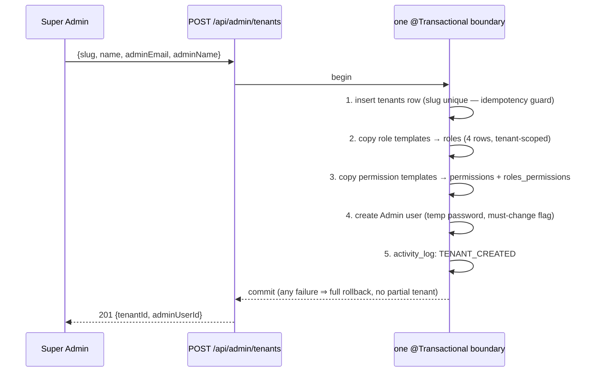
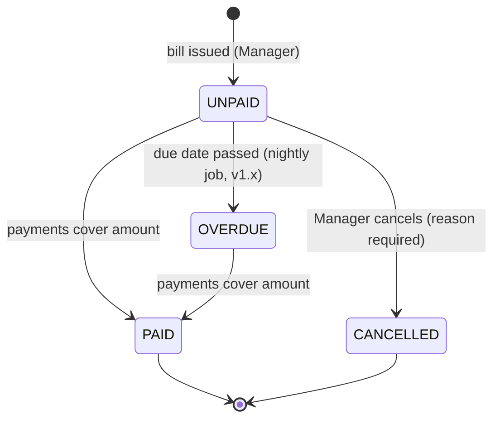
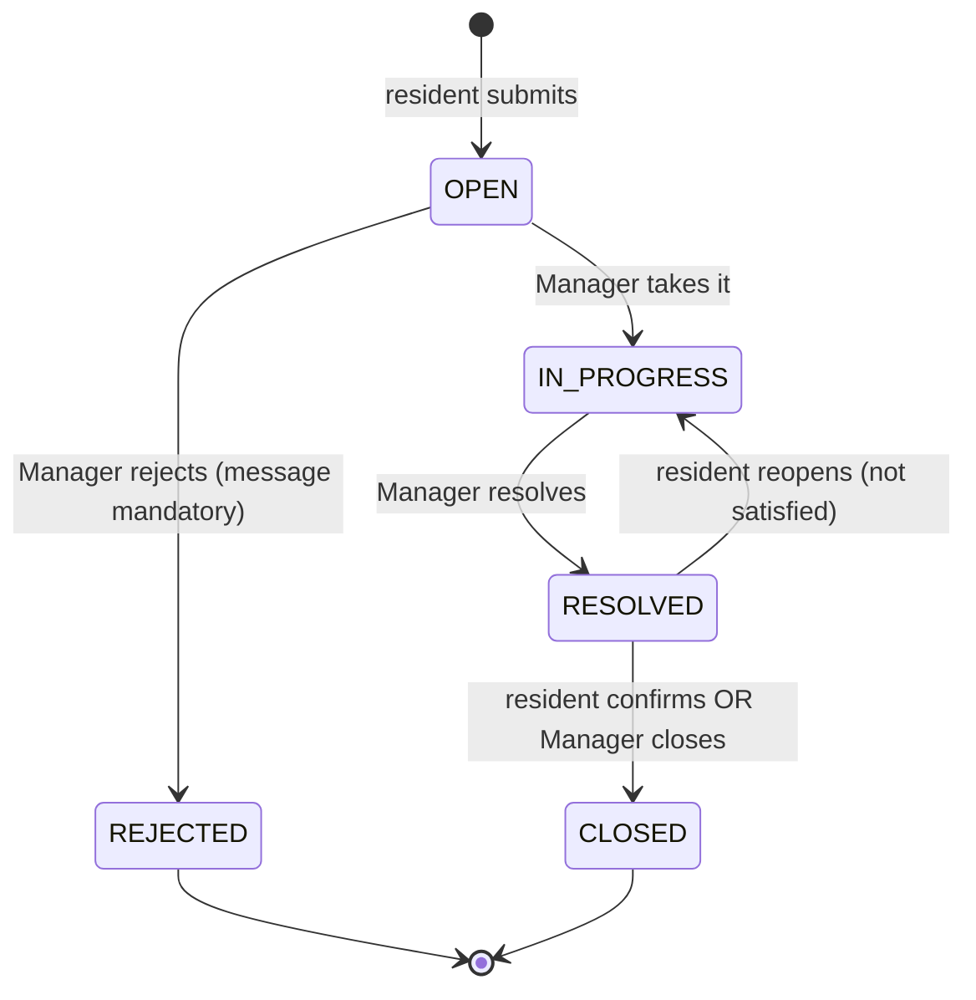

# BAiTI — System Analysis

> **Blueprint document 2 of 9** | Produced: 2026-07-07
> Translates the SRS into modules, use cases, workflows (state machines), journeys, data flows, and the access-control matrix. Requirement IDs (FR-…) refer to `01_SRS.md`.

---

## 1. Scope

### In scope (v1.0)
Tenancy foundation · Auth/RBAC · Property (blocks, units) · Residents + family · Finance (bills, payments, methods) · Complaints · Maintenance · in-app notification records for M-priority triggers · Activity/audit log · Role dashboards (counts only).

### In scope (v1.x)
Facilities + bookings · Visitors + pre-registration · Announcements + events · Notification centre UI · Overdue/arrears job.

### Explicitly out of scope (non-goals until re-decided)
Payment gateway processing · mobile apps · multi-currency · Bahasa Malaysia strings (i18n scaffold only) · accounting/GL export · document management beyond single-file attachments · chat/messaging · IoT (barrier gates, intercom) · tenant self-signup (Super Admin onboards tenants manually) · email/SMS delivery (interface stubbed, channel = in-app only).

---

## 2. Module Map & Boundaries

```
                        ┌────────────────────────────────────────────┐
                        │                cross-cutting               │
                        │  tenancy · security · common · system      │
                        └────────────────────────────────────────────┘
   property ──▶ people ──▶ finance          complaints ──▶ system(notifications)
   (blocks,     (users,     (bills ←unit,    (complaints ←resident+unit+category)
    units)      residents,   payments ←bill+resident+method)
                family)      maintenance ←unit+resident
   facilities ←residents    community (announcements, events)   visitors ←residents
```

| Module (Java package `my.baiti.*`) | Owns tables | Exposes to other modules (interface only) | Depends on |
|---|---|---|---|
| `tenancy` | tenants | `TenantContext` (read), tenant admin API | — |
| `security` | refresh_tokens, super_admins | `CurrentUser`, permission evaluator | tenancy |
| `people` | users, roles, permissions, roles_permissions, residents, family_members | `UserService`, `ResidentService` (lookup) | security |
| `property` | blocks, units | `UnitService` (lookup, occupancy hook) | — |
| `finance` | payment_methods, bills, payments | `BillService` (query for dashboards) | property, people |
| `complaints` | complaint_categories, complaints, complaint_updates | — | people, property, system |
| `maintenance` | maintenance_requests | — | people, property, system |
| `facilities` | facilities, facility_bookings | — | people, system |
| `community` | announcements, events | — | people |
| `visitors` | visitors, visitor_pre_registrations | — | people, system |
| `system` | notifications, activity_logs | `NotificationService`, `ActivityLogService` | people |
| `common` | — (base entity, errors, paging) | `TenantAwareBaseEntity`, `ApiError` | — |

**Boundary rules** (ArchUnit-enforced): cross-module calls go through service interfaces, never repositories; only `security` imports JWT internals; every domain entity extends `TenantAwareBaseEntity`.

---

## 3. Use Case Inventory

Format: UC-id · primary actor · goal. Detailed flows exist only where behaviour is non-obvious (§4); CRUD use cases inherit the standard flow (validate → authorise → mutate → audit → respond).

### Tenancy & platform
- **UC-T1** Super Admin · onboard tenant (FR-TEN-01/02) — see §4.1
- **UC-T2** Super Admin · suspend/reactivate tenant (FR-TEN-06)
- **UC-T3** Super Admin · list tenants, view platform health

### Auth & account
- **UC-A1** Any user · log in (FR-AUTH-01) — see §4.2
- **UC-A2** Any user · refresh session silently (FR-AUTH-03)
- **UC-A3** Any user · log out; **UC-A4** view own profile (`/auth/me`)
- **UC-A5** Admin · create staff/resident user, assign role (FR-RBAC-05)
- **UC-A6** Admin · deactivate user (revokes refresh tokens)

### Property & people
- **UC-P1** Admin · set up blocks and units (FR-PROP-01/02)
- **UC-P2** Admin/Manager · register resident to unit (FR-RES-01/02)
- **UC-P3** Resident/Admin · manage family members (FR-RES-03)
- **UC-P4** Admin · move resident out (FR-RES-04)

### Finance
- **UC-F1** Manager · issue monthly bills (FR-FIN-01)
- **UC-F2** Manager · record payment with proof (FR-FIN-02/03) — see §4.3
- **UC-F3** Resident · view own bills/payments (FR-FIN-04)
- **UC-F4** Admin · manage payment methods (FR-FIN-05)
- **UC-F5** System · flag overdue bills nightly (FR-FIN-07, v1.x)

### Complaints & maintenance
- **UC-C1** Resident · submit complaint (FR-CMP-01) — see §4.4
- **UC-C2** Manager · progress complaint with updates (FR-CMP-02/03)
- **UC-C3** Resident · track own complaint trail
- **UC-M1** Resident · raise maintenance request (FR-MNT-01)
- **UC-M2** Manager · triage/progress request queue (FR-MNT-02/03)

### v1.x
- **UC-B1** Resident · book facility; **UC-B2** Manager · approve/reject (FR-FAC-02/03) — see §4.5
- **UC-V1** Resident · pre-register visitor (FR-VIS-01); **UC-V2** Guard · verify code & check in/out (FR-VIS-02/03) — see §4.6
- **UC-N1** Manager · post announcement (FR-COM-01); **UC-N2** Manager · manage events (FR-COM-02)
- **UC-X1** User · read notifications (FR-NOT-02)
- **UC-L1** Admin · review activity log (FR-AUD-02)

---

## 4. Key Business Workflows

### 4.1 Tenant onboarding (UC-T1) — must be atomic


Duplicate slug ⇒ 409, nothing written. **Note**: this transaction runs in the super-admin context, which operates outside normal tenant RLS scoping — see 03_ARCHITECTURE §6.5.

### 4.2 Login & tenant resolution (UC-A1)

1. Client sends `POST /api/auth/login` with credentials; tenant resolved from `X-Tenant-Slug` header (dev) / subdomain (prod) **before** authentication.
2. Unknown slug ⇒ generic 401 (no tenant-existence oracle, FR-AUTH-05). Suspended tenant ⇒ same generic 401.
3. Rate limiter checks (tenant,email) and IP buckets (FR-AUTH-06) ⇒ 429 when exceeded.
4. bcrypt verify; on success issue access JWT (claims `userId`,`tenantId`,`roles`,`permissions`) + rotating refresh token persisted in `refresh_tokens`.
5. `activity_logs` ← LOGIN_SUCCESS / LOGIN_FAILURE (async).

### 4.3 Bill → payment lifecycle (UC-F1/F2)


Recording a payment (one transaction): validate bill is payable → validate `amount_paid ≤ outstanding balance` → insert payment (method FK, receipt no, optional proof file via StorageService) → recompute status → notification to unit's residents → audit. Payments are immutable once written; corrections are compensating entries (accounting discipline, keeps the audit trail honest).

### 4.4 Complaint lifecycle (UC-C1/C2)


Every transition writes a `complaint_updates` row (updated_by, message, resulting status) — the trail IS the collaboration record. Transitions emit notifications: to Managers on OPEN, to the resident on every other transition. Maintenance requests follow the same pattern with states `PENDING → APPROVED → IN_PROGRESS → COMPLETED / REJECTED`.

### 4.5 Facility booking (UC-B1/B2, v1.x)

`PENDING → APPROVED | REJECTED`, `PENDING/APPROVED → CANCELLED` (by booker before slot start). Double-booking prevented by DB constraint on (tenant_id, facility_id, booking_date, time_slot) where status in (PENDING, APPROVED) — a partial unique index, not application logic alone.

### 4.6 Visitor flow (UC-V1/V2, v1.x)

Pre-registration: resident creates → system generates approval code (unique per tenant, single-use, valid on visit_date only) → status `PENDING`. At the gate: Guard enters code → system shows visitor+host → Guard confirms ⇒ `visitors` row created with entry_time, pre-registration marked `USED`. Walk-in: Guard creates `visitors` row directly against a host resident. Exit: Guard stamps exit_time. On-site list = entry_time set, exit_time null.

---

## 5. User Journeys (v1.0 critical paths)

| # | Journey | Steps | Success signal |
|---|---|---|---|
| J1 | **Admin first-hour setup** | login (temp password → forced change) → create blocks → bulk-add units → add Manager/Guard users → register first residents | A resident can log in and see their unit |
| J2 | **Monthly billing run** | Manager → Finance → issue bills for month (per unit or bulk) → residents notified → resident views bill → pays offline → Manager records payment + proof → bill shows PAID | Zero bills in ambiguous state; balances correct |
| J3 | **Complaint round-trip** | Resident submits (photo later, v1.x) → Manager notified → takes → resolves with message → resident confirms close | Trail shows every hop with timestamps |
| J4 | **Guard shift** (v1.x) | Guard logs in on gate device → verifies code → checks in → checks out at exit | On-site list accurate at all times |
| J5 | **Platform onboarding** | Super Admin creates tenant → hands temp Admin credentials → J1 begins | Tenant fully seeded, isolated from day 0 |

Journey J1 defines the UI build order for the frontend packets: auth screens → property screens → people screens → finance → complaints.

---

## 6. Data Flow Views

### 6.1 The one request path everything follows

```
React (TanStack Query) → Axios (+JWT, +X-Tenant-Slug)
  → Spring Security filter chain: JWT validate → load principal
  → TenantContextFilter: claim vs resolved tenant match → TenantContext (ThreadLocal)
  → Controller (@Valid DTO, @PreAuthorize permission)
  → Service (business rules, @Transactional; own-record scoping for Residents)
  → Repository (JPA) → PostgreSQL [RLS: rows WHERE tenant_id = app.current_tenant]
  ← DTO response ← (async: ActivityLog, Notification via Spring events)
```

### 6.2 Side-effect flow (decoupled)

Domain services publish Spring application events (`ComplaintCreated`, `PaymentRecorded`, …). Two async listeners consume them: `ActivityLogListener` (audit rows) and `NotificationListener` (notification rows). Listener failure logs an error and never propagates (FR-AUD-03). This is in-process eventing — a message broker is deliberately NOT introduced at this scale (see 03_ARCHITECTURE §10).

### 6.3 Reporting/dashboard flow
Dashboards are plain aggregate queries (counts by status per tenant) behind the same RLS path — no separate read store at v1.0 scale.

---

## 7. External Integrations

| Integration | v1.0 | Later | Boundary |
|---|---|---|---|
| File storage (payment proofs, attachments) | Local filesystem volume | S3-compatible object store | `StorageService` interface from day 1 |
| Email | none (log-only stub) | SMTP provider for password reset, digests | `NotificationChannel` interface |
| SMS/WhatsApp | none | visitor codes, OTP | same interface |
| Payment gateway (FPX/card) | none — manual recording | Stripe/Billplz/toyyibPay evaluation | new `finance.gateway` sub-module; payments table already gateway-shaped (receipt_no, method FK) |
| Monitoring | Actuator + Prometheus scrape | hosted Grafana / alerting | standard endpoints |

No third-party integration is on the v1.0 critical path — this is deliberate de-risking.

---

## 8. Access-Control Matrix (role × permission)

Permission naming: `<RESOURCE>_<ACTION>`; `_ALL` suffix = tenant-wide scope, `_OWN` = own-records scope. This grid IS the seed content for `roles_permissions` templates (Packet 05) and the parametrised authorisation test matrix (06_TESTING_STRATEGY §5.3). ✓ = granted by default; Admin-editable per tenant (FR-RBAC-02).

| Permission | Admin | Manager | Resident | Guard |
|---|---|---|---|---|
| TENANT_SETTINGS_MANAGE | ✓ | — | — | — |
| USER_MANAGE / ROLE_MANAGE | ✓ | — | — | — |
| BLOCK_MANAGE / UNIT_MANAGE | ✓ | — | — | — |
| UNIT_READ_ALL | ✓ | ✓ | — | ✓ (unit no only) |
| RESIDENT_MANAGE | ✓ | ✓ | — | — |
| RESIDENT_READ_ALL | ✓ | ✓ | — | ✓ (name+unit only, D-baseline #5) |
| FAMILY_MANAGE_OWN | — | — | ✓ | — |
| BILL_MANAGE (issue/cancel) | ✓ | ✓ | — | — |
| BILL_READ_ALL | ✓ | ✓ | — | — |
| BILL_READ_OWN / PAYMENT_READ_OWN | — | — | ✓ | — |
| PAYMENT_RECORD | ✓ | ✓ | — | — |
| PAYMENT_METHOD_MANAGE | ✓ | — | — | — |
| COMPLAINT_CREATE_OWN | — | — | ✓ | — |
| COMPLAINT_READ_OWN | — | — | ✓ | — |
| COMPLAINT_READ_ALL / COMPLAINT_PROGRESS | ✓ | ✓ | — | — |
| COMPLAINT_CATEGORY_MANAGE | ✓ | — | — | — |
| MAINTENANCE_CREATE_OWN / READ_OWN | — | — | ✓ | — |
| MAINTENANCE_READ_ALL / PROGRESS | ✓ | ✓ | — | — |
| FACILITY_MANAGE | ✓ | — | — | — |
| FACILITY_READ | ✓ | ✓ | ✓ | ✓ |
| BOOKING_CREATE_OWN / READ_OWN / CANCEL_OWN | — | — | ✓ | — |
| BOOKING_READ_ALL / APPROVE | ✓ | ✓ | — | — |
| ANNOUNCEMENT_MANAGE / EVENT_MANAGE | ✓ | ✓ | — | — |
| ANNOUNCEMENT_READ / EVENT_READ | ✓ | ✓ | ✓ | ✓ |
| VISITOR_PREREG_CREATE_OWN / READ_OWN | — | — | ✓ | — |
| VISITOR_CHECKIN / CHECKOUT / READ_ONSITE | ✓ | ✓ | — | ✓ |
| NOTIFICATION_READ_OWN | ✓ | ✓ | ✓ | ✓ |
| ACTIVITY_LOG_READ | ✓ | — | — | — |

Super Admin is **not** in this grid: super-admin permissions (`TENANT_CREATE`, `TENANT_SUSPEND`, `TENANT_READ_ALL`, `PLATFORM_LOG_READ`) live outside tenant RBAC entirely (separate `super_admins` principal, separate `/api/admin/**` chain — 03_ARCHITECTURE §7.5).

---

## 9. Analysis-Level Risks Surfaced

| Risk | Treatment in blueprint |
|---|---|
| "Tenant" word collision (SaaS tenant vs renting resident) confuses every future contributor | Glossary in SRS §1.3; code uses `Tenant` (SaaS) vs `residentType=TENANT` only in the residents domain; UI copy says "community" for SaaS tenant |
| Own-record scoping (Residents) is app-layer only — RLS can't express it | Explicit service-layer predicate + dedicated authorisation tests per own-scoped endpoint (06_TESTING §5.3) |
| Booking double-slot race | DB partial unique index, not app checks (04_DATABASE §5) |
| Notification fan-out volume (bill run × residents) | Batch insert in one statement; still trivial at v1.0 scale |
| Guard device shares a browser at the gate | Short refresh TTL is global v1.0; per-role session policy deferred, noted in backlog |
