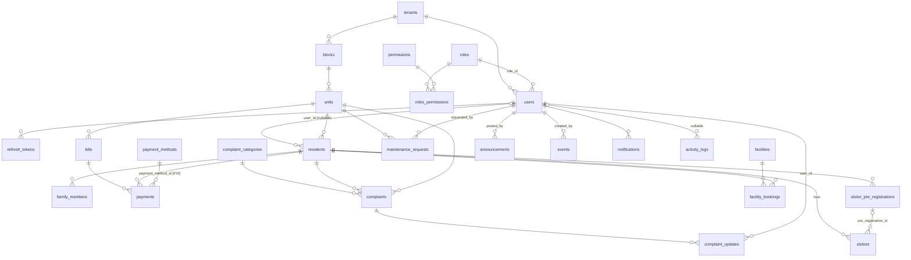

# BAiTI — Database Design

> **Blueprint document 4 of 9** | Produced: 2026-07-07
> **Normative.** This document — not the PDF, not the 2026-04-08 plan — is the DDL source for migrations. It incorporates every correction from `00_REPOSITORY_INVENTORY.md §3` and fixes the migration-ordering defect. PDF column fidelity is preserved unless a row in §9 says otherwise.

---

## 1. Design Rules (apply to every table unless marked global)

1. **PK**: `id UUID PRIMARY KEY DEFAULT gen_random_uuid()` (built into PG ≥13 — no extension needed).
2. **Tenancy**: `tenant_id UUID NOT NULL REFERENCES tenants(id) ON DELETE RESTRICT` on every tenant-scoped table, including pivots.
3. **Audit columns**: `created_at TIMESTAMPTZ NOT NULL DEFAULT now()`, `updated_at TIMESTAMPTZ NOT NULL DEFAULT now()`, `created_by UUID NULL`, `updated_by UUID NULL`. `created_by/updated_by` are **plain UUIDs, deliberately not FKs** — they are audit stamps, not relations; this also removes migration-order coupling to `users`. Domain-meaningful user references (`posted_by`, `requested_by`, `user_id` on complaint_updates, `approved_by`) **are** real FKs.
4. **Time**: `TIMESTAMPTZ` only, UTC. Calendar concepts (`billing_month`, `due_date`, `booking_date`, `visit_date`) are `DATE`.
5. **Money**: `NUMERIC(12,2)` + `currency CHAR(3) DEFAULT 'MYR'`. Floats are forbidden schema-wide.
6. **Enums**: `TEXT` + `CHECK (col IN (...))`, mapped `@Enumerated(EnumType.STRING)`. Why not native PG enums: adding values later is one `ALTER TABLE … DROP/ADD CONSTRAINT` in a new migration instead of `ALTER TYPE` gymnastics, and JPA mapping stays trivial.
7. **Text**: `TEXT` everywhere (PG has no perf penalty); `CITEXT` for emails and tenant slugs (case-insensitive uniqueness).
8. **FK deletes**: `ON DELETE RESTRICT` everywhere except `roles_permissions` (CASCADE from either side — pure pivot). Business "deletion" is a status change; hard deletes are for admin-corrected mistakes only.
9. **Uniqueness is always tenant-scoped**: `UNIQUE (tenant_id, …)` — never global uniques on domain data.
10. **Every FK column gets an index** (PostgreSQL does not auto-index FK columns); composite indexes lead with `tenant_id`.

## 2. Relation Inventory — 26 relations

| Kind | Tables | Count |
|---|---|---|
| Platform-global (no tenant_id, no tenant RLS) | `tenants`, `super_admins` | 2 |
| Tenant-scoped domain | `users`, `roles`, `permissions`, `roles_permissions`, `refresh_tokens`, `blocks`, `units`, `residents`, `family_members`, `payment_methods`, `bills`, `payments`, `complaint_categories`, `complaints`, `complaint_updates`, `maintenance_requests`, `facilities`, `facility_bookings`, `announcements`, `events`, `visitors`, `visitor_pre_registrations`, `notifications`, `activity_logs` | 24 |

Count reconciliation: 23 PDF tables (the "22" in older docs was a miscount) + `tenants` + `refresh_tokens` + `super_admins` (decision D6) = 26. **Role/permission templates are code, not tables** — a `PermissionCatalog` enum + default role-grant map in `my.baiti.people`, copied into tenant-scoped rows at onboarding by `TenantOnboardingService`, and idempotently synced per tenant at startup when a release adds permissions. Why: the catalog must match `@PreAuthorize` string constants anyway — keeping it in code makes drift a compile error, and it eliminates three global tables plus their RLS exceptions.

Sync preserves tenant customisation (FR-RBAC-02): existing roles receive defaults
only for newly introduced catalogue codes and only when marked as system roles.
Missing default roles are initialised from templates; existing-code grant changes
or revocations remain untouched. Per-tenant sync is transactional and serialised.
This 4 November application-policy clarification changes no table or migration.

## 3. ERD (corrected, compact)


(Every tenant-scoped entity also has `tenant_id → tenants`; omitted above for readability.)

## 4. Table Specifications

Base columns (§1.1–1.3) are implied on every table below and not repeated. `⊕idx` = secondary index.

### 4.1 Platform-global

**tenants** — `slug CITEXT NOT NULL UNIQUE CHECK (slug ~ '^[a-z0-9-]{3,50}$')` · `name TEXT NOT NULL` · `status TEXT NOT NULL DEFAULT 'ACTIVE' CHECK (ACTIVE|SUSPENDED)`. No tenant_id. RLS: enabled with a **deny-all default** (no policy for `baiti_app` beyond `SELECT` of own row via `id = current_setting('app.current_tenant',true)::uuid`); super-admin operations use the privileged path (03_ARCHITECTURE §6.5).

**super_admins** — `email CITEXT NOT NULL UNIQUE` · `name TEXT NOT NULL` · `password_hash TEXT NOT NULL` · `status TEXT NOT NULL DEFAULT 'ACTIVE'` · `last_login_at TIMESTAMPTZ`. Why a separate table (D6 locked): tenant `users` participate in tenant RLS and tenant RBAC; mixing platform operators in would demand NULL-tenant exceptions in every policy — a standing foot-gun.

### 4.2 People & access (tenant-scoped)

**permissions** — `code TEXT NOT NULL` (machine name, e.g. `BILL_MANAGE`; renamed from PDF `name`) · `module TEXT NOT NULL` · `description TEXT` · `UNIQUE (tenant_id, code)`.

**roles** — `name TEXT NOT NULL` · `description TEXT` · `is_system BOOLEAN NOT NULL DEFAULT false` (seeded Admin/Manager/Resident/Guard roles are undeletable) · `UNIQUE (tenant_id, name)`.

**roles_permissions** — `role_id UUID NOT NULL REFERENCES roles ON DELETE CASCADE` · `permission_id UUID NOT NULL REFERENCES permissions ON DELETE CASCADE` · `tenant_id` (required for RLS even on pivots) · `PRIMARY KEY (role_id, permission_id)` ⊕idx (permission_id). PDF's `premission_id` typo corrected.

**users** — `name TEXT NOT NULL` · `email CITEXT NOT NULL` · `password_hash TEXT NOT NULL` (renamed from PDF `password`) · `role_id UUID NOT NULL REFERENCES roles ON DELETE RESTRICT` · `status TEXT NOT NULL DEFAULT 'ACTIVE' CHECK (ACTIVE|INACTIVE)` · `must_change_password BOOLEAN NOT NULL DEFAULT false` · `last_login_at TIMESTAMPTZ` · `UNIQUE (tenant_id, email)` ⊕idx (role_id). Single role per user preserved from PDF (ASM-5; escape path = introduce `users_roles` pivot, drop `role_id`, one data migration).

**refresh_tokens** — `user_id UUID NOT NULL REFERENCES users ON DELETE CASCADE` · `token_hash TEXT NOT NULL UNIQUE` (SHA-256 of the opaque token; raw token never stored) · `family_id UUID NOT NULL` · `expires_at TIMESTAMPTZ NOT NULL` · `rotated_at TIMESTAMPTZ` · `revoked_at TIMESTAMPTZ` ⊕idx (user_id), (family_id), (expires_at) for purge job. **[FIX] Created before the RLS migration**, unlike the old V28 plan.

### 4.3 Property

**blocks** — `name TEXT NOT NULL` · `description TEXT` · `UNIQUE (tenant_id, name)`. (PDF `block`/`Name` → plural table, lowercase columns.)

**units** — `block_id UUID NOT NULL REFERENCES blocks ON DELETE RESTRICT` · `unit_no TEXT NOT NULL` · `type TEXT` · `floor_no TEXT` (TEXT not INT: floors "G", "M", "3A" exist; PDF `Floor_no` case fixed) · `status TEXT NOT NULL DEFAULT 'VACANT' CHECK (OCCUPIED|VACANT)` · `UNIQUE (tenant_id, block_id, unit_no)` ⊕idx (block_id).

### 4.4 Residency

**residents** — `user_id UUID NULL REFERENCES users ON DELETE RESTRICT` (nullable: record can precede portal account, FR-RES-01) · `unit_id UUID NOT NULL REFERENCES units ON DELETE RESTRICT` · `name TEXT NOT NULL` · `phone TEXT` · `email CITEXT` · `resident_type TEXT NOT NULL CHECK (OWNER|TENANT)` (PDF "Owner/Type" corrected; see SRS §1.3 for the tenant-word disambiguation) · `status TEXT NOT NULL DEFAULT 'ACTIVE' CHECK (ACTIVE|MOVED_OUT)` ⊕idx (unit_id), (user_id) · partial unique `UNIQUE (tenant_id, user_id) WHERE user_id IS NOT NULL AND status = 'ACTIVE'` (one active residency per portal account, FR-RES-02).

**family_members** — `resident_id UUID NOT NULL REFERENCES residents ON DELETE CASCADE` · `name TEXT NOT NULL` · `relationship TEXT` · `age SMALLINT CHECK (age BETWEEN 0 AND 150)` (PDF fidelity; known caveat: age goes stale — v1.x may add `date_of_birth` and derive) · `contact_no TEXT` ⊕idx (resident_id).

### 4.5 Finance

**payment_methods** — `name TEXT NOT NULL` (renamed from PDF `method_name` for schema-wide consistency) · `description TEXT` · `is_active BOOLEAN NOT NULL DEFAULT true` · `UNIQUE (tenant_id, name)`.

**bills** — `unit_id UUID NOT NULL REFERENCES units ON DELETE RESTRICT` · `billing_month DATE NOT NULL` (convention: first day of month; CHECK `date_trunc('month',billing_month) = billing_month`) · `bill_type TEXT NOT NULL DEFAULT 'MAINTENANCE_FEE'` (reserved enum, SRS §8.4) · `description TEXT` · `amount NUMERIC(12,2) NOT NULL CHECK (amount > 0)` · `currency CHAR(3) NOT NULL DEFAULT 'MYR'` · `status TEXT NOT NULL DEFAULT 'UNPAID' CHECK (UNPAID|PAID|OVERDUE|CANCELLED)` · `due_date DATE NOT NULL` · `cancelled_reason TEXT` · `UNIQUE (tenant_id, unit_id, billing_month, bill_type)` (FR-FIN-01 duplicate guard) ⊕idx (unit_id), (tenant_id, status), (tenant_id, due_date) WHERE status = 'UNPAID' (overdue job). Table renamed from PDF `bilings`.

**payments** — `bill_id UUID NOT NULL REFERENCES bills ON DELETE RESTRICT` · `resident_id UUID NOT NULL REFERENCES residents ON DELETE RESTRICT` · `amount_paid NUMERIC(12,2) NOT NULL CHECK (amount_paid > 0)` · `payment_method_id UUID NOT NULL REFERENCES payment_methods ON DELETE RESTRICT` (**[FIX] normalized** — PDF had free-text `payment_method` beside an unused `payment_methods` table) · `receipt_no TEXT` · `proof_file TEXT` (StorageService key, not a path) · `paid_at TIMESTAMPTZ NOT NULL DEFAULT now()` ⊕idx (bill_id), (resident_id). **Append-only**: no UPDATE/DELETE endpoints; corrections are compensating rows (02_SYSTEM_ANALYSIS §4.3). Bill-balance invariant (Σ payments ≤ bill.amount) is enforced in the service inside the same transaction with the bill row locked (`SELECT … FOR UPDATE`) — a DB trigger was considered and rejected (logic split across layers hurts testability; the lock closes the race).

### 4.6 Complaints & maintenance

**complaint_categories** — `name TEXT NOT NULL` · `description TEXT` · `UNIQUE (tenant_id, name)`.

**complaints** — `resident_id UUID NOT NULL REFERENCES residents` · `unit_id UUID NOT NULL REFERENCES units` · `category_id UUID NOT NULL REFERENCES complaint_categories ON DELETE RESTRICT` · `title TEXT NOT NULL` · `description TEXT NOT NULL` · `status TEXT NOT NULL DEFAULT 'OPEN' CHECK (OPEN|IN_PROGRESS|RESOLVED|CLOSED|REJECTED)` · `submitted_at TIMESTAMPTZ NOT NULL DEFAULT now()` (PDF `submitted at` fixed) ⊕idx (resident_id), (tenant_id, status), (category_id).

**complaint_updates** — `complaint_id UUID NOT NULL REFERENCES complaints ON DELETE RESTRICT` · `user_id UUID NOT NULL REFERENCES users ON DELETE RESTRICT` · `message TEXT NOT NULL` · `status TEXT NOT NULL` (resulting status; same CHECK as complaints) ⊕idx (complaint_id), (user_id). PDF `update_at` folded into base `created_at`. Table renamed from `complaints_updates`. The domain actor uses `user_id` to avoid colliding with the nullable `updated_by` audit stamp; this records the existing V18 correction and JPA mapping, without rewriting an applied migration. The parent association cascades persist/merge only, with no orphan removal: deleting a complaint with history must reach the RESTRICT FK, and clearing its collection must not erase history. This association rule is not a full append-only database policy.

**maintenance_requests** — `unit_id UUID NOT NULL REFERENCES units` · `requested_by UUID NOT NULL REFERENCES users` · `description TEXT NOT NULL` · `priority TEXT NOT NULL DEFAULT 'MEDIUM' CHECK (LOW|MEDIUM|HIGH|URGENT)` · `status TEXT NOT NULL DEFAULT 'PENDING' CHECK (PENDING|APPROVED|IN_PROGRESS|COMPLETED|REJECTED)` ⊕idx (unit_id), (tenant_id, status, priority).

### 4.7 Facilities, community, visitors (v1.x tables — created with the rest; features later)

**facilities** — `name TEXT NOT NULL` · `location TEXT` · `capacity INTEGER CHECK (capacity > 0)` · `rules TEXT` · `status TEXT NOT NULL DEFAULT 'AVAILABLE' CHECK (AVAILABLE|MAINTENANCE|CLOSED)` · `UNIQUE (tenant_id, name)`.

**facility_bookings** — `facility_id UUID NOT NULL REFERENCES facilities` · `resident_id UUID NOT NULL REFERENCES residents` · `booking_date DATE NOT NULL` · `time_slot TEXT NOT NULL` (label "08:00-10:00"; a slots table is deliberate v2 normalization) · `status TEXT NOT NULL DEFAULT 'PENDING' CHECK (PENDING|APPROVED|REJECTED|CANCELLED)` · `approved_by UUID NULL REFERENCES users` ⊕idx (resident_id) · **partial unique** `UNIQUE (tenant_id, facility_id, booking_date, time_slot) WHERE status IN ('PENDING','APPROVED')` — the DB, not the app, kills double-booking races (FR-FAC-02).

**announcements** — `title TEXT NOT NULL` (PDF `tittle`) · `content TEXT NOT NULL` · `posted_by UUID NOT NULL REFERENCES users` · `attachment TEXT` · `target_audience TEXT NOT NULL DEFAULT 'ALL' CHECK (ALL|OWNERS|TENANTS)` · `posted_at TIMESTAMPTZ NOT NULL DEFAULT now()` ⊕idx (tenant_id, posted_at DESC).

**events** — `title TEXT NOT NULL` (PDF `tittle`) · `start_date TIMESTAMPTZ NOT NULL` · `end_date TIMESTAMPTZ NOT NULL` · `location TEXT` (PDF `loacation`) · `description TEXT` · `created_by UUID NOT NULL REFERENCES users` · CHECK `end_date >= start_date` ⊕idx (tenant_id, start_date).

**visitors** — `resident_id UUID NOT NULL REFERENCES residents` (host) · `pre_registration_id UUID NULL REFERENCES visitor_pre_registrations` (design addition: links gate check-in to its pre-reg) · `name TEXT NOT NULL` · `vehicle_no TEXT` · `visit_reason TEXT` · `entry_time TIMESTAMPTZ` · `exit_time TIMESTAMPTZ` · `status TEXT NOT NULL DEFAULT 'CHECKED_IN' CHECK (CHECKED_IN|CHECKED_OUT)` · CHECK `exit_time IS NULL OR (entry_time IS NOT NULL AND exit_time >= entry_time)` ⊕idx (resident_id) · partial idx `(tenant_id) WHERE exit_time IS NULL` (on-site list).

**visitor_pre_registrations** — `resident_id UUID NOT NULL REFERENCES residents` · `visitor_name TEXT NOT NULL` · `visit_date DATE NOT NULL` · `approval_code TEXT NOT NULL` · `status TEXT NOT NULL DEFAULT 'PENDING' CHECK (PENDING|USED|EXPIRED|CANCELLED)` · `UNIQUE (tenant_id, approval_code)` ⊕idx (resident_id), (tenant_id, visit_date).

### 4.8 System

**notifications** — `user_id UUID NOT NULL REFERENCES users ON DELETE CASCADE` · `title TEXT NOT NULL` · `message TEXT NOT NULL` (PDF `messaage`; table renamed from singular `notification`) · `is_read BOOLEAN NOT NULL DEFAULT false` ⊕idx (user_id, is_read).

**activity_logs** — `user_id UUID NULL` (plain UUID, no FK — survives user hard-delete; NULL for anonymous events like failed logins) · `action TEXT NOT NULL` (catalogued constants: `LOGIN_SUCCESS`, `BILL_CREATED`, …) · `detail JSONB` (design addition: structured context — entity id, before/after summary) · `ip_address INET` · append-only (FR-AUD-02; no update/delete via app; `baiti_app` gets no UPDATE/DELETE grant on this table) ⊕idx (tenant_id, created_at DESC), (tenant_id, user_id).

## 5. Row-Level Security (normative DDL pattern)

Original pattern in immutable V28, applied to all 24 tenant-scoped tables:

```sql
ALTER TABLE {t} ENABLE ROW LEVEL SECURITY;
ALTER TABLE {t} FORCE ROW LEVEL SECURITY;          -- binds even the owner
CREATE POLICY tenant_isolation ON {t}
  USING (tenant_id = current_setting('app.current_tenant', true)::uuid)
  WITH CHECK (tenant_id = current_setting('app.current_tenant', true)::uuid);
```

- `current_setting(…, true)` returns NULL for a never-set GUC, but RESET/empty/malformed settings exposed UUID-cast errors in real PG16 tests on 29 October. The effective V29 contract below replaces that direct cast without editing V28.
- `WITH CHECK` blocks writing rows *into* another tenant, not just reading.
- Runtime role `baiti_app` is `NOBYPASSRLS`; Flyway runs as `baiti_migrator` (03_ARCHITECTURE §6.2). Grants: `V1` sets `ALTER DEFAULT PRIVILEGES … GRANT SELECT,INSERT,UPDATE,DELETE ON TABLES TO baiti_app`, then the RLS migration **revokes** UPDATE/DELETE on `activity_logs` and `payments` (append-only enforcement in the grant layer too).
- `tenants`: RLS enabled with a narrow app self-row SELECT policy (§4.1). `super_admins`: RLS enabled/forced with **no policy for `baiti_app`**. FORCE RLS binds the ordinary migrator too; V30 below explicitly provides its bounded global data access. V29 alone did not provide that path.

**V29 forward repair — 29 October 2026, F0/F1:** `public.baiti_current_tenant()`
returns the canonical setting as UUID, or NULL for absent, empty, wrong-length
or invalid UUID text. It is STABLE, SECURITY INVOKER, with a pg_catalog-only
search path and explicit execution grants to app/migrator. It does not confer
owner privileges or provide platform access; see the separate V30 contract.

```sql
CREATE OR REPLACE FUNCTION public.baiti_current_tenant()
RETURNS UUID
LANGUAGE plpgsql
STABLE
SECURITY INVOKER
SET search_path = pg_catalog
AS $function$
DECLARE
    tenant_setting TEXT;
BEGIN
    tenant_setting := current_setting('app.current_tenant', true);
    IF tenant_setting IS NULL OR length(tenant_setting) <> 36 THEN
        RETURN NULL;
    END IF;
    RETURN tenant_setting::UUID;
EXCEPTION WHEN invalid_text_representation THEN
    RETURN NULL;
END;
$function$;
REVOKE ALL ON FUNCTION public.baiti_current_tenant() FROM PUBLIC;
GRANT EXECUTE ON FUNCTION public.baiti_current_tenant() TO baiti_app, baiti_migrator;
```

V29 alters only the named 24 tenant_isolation policies to use
`tenant_id = public.baiti_current_tenant()` in both USING and WITH CHECK, and
tenant_self_select to use `id = public.baiti_current_tenant()`. The explicit
table allowlist is the existing V28 list; unrelated tables are untouched.
RLS/FORCE, table ownership, roles and append-only grants stay in force. NULL
predicates read zero rows and reject inserts with SQL state 42501; a valid
tenant still needs all application authorization/context checks. This narrow
context repair is unrelated to the earlier Gemini conceptual V29 feature bundle.

**V30 platform policies — 29 October 2026, ADR 0003:** FORCE RLS continues to
bind `baiti_migrator`. The intended separate platform datasource gets six
explicit policies: on each of `tenants` and `super_admins`, `platform_select`
is FOR SELECT TO baiti_migrator USING (true), `platform_insert` is FOR INSERT
TO baiti_migrator WITH CHECK (true), and `platform_update` is FOR UPDATE TO
baiti_migrator USING (true) WITH CHECK (true). There is no platform DELETE or
FOR ALL policy and no new PUBLIC/app policy. Tenant self-read and all 24 domain
policies are unchanged. This enables the trusted owner's intended data path;
it neither removes that owner's existing DDL authority nor implements the
separate P05 platform authentication/service boundary. No runtime pool may use
the migrator identity.

**V31 foreign-key indexes — 29 October 2026:** the P03 catalog regression found
six missing indexes under section 1.10. Add unconditional leading-column indexes
for `announcements(posted_by)`, `complaints(unit_id)`, `events(created_by)`,
`facility_bookings(approved_by)`, `maintenance_requests(requested_by)` and
`visitors(pre_registration_id)`. No column, FK, policy, grant or existing index
definition changes. The regression accepts an existing valid unconditional
index whose leading key columns cover the FK, including a suitable existing
unique/primary index; it does not claim benchmarked query performance.

## 6. Migration Sequence — corrected (supersedes plan §5.4 and §8)

Ordering rules that fixed the old defects: *(a)* every table exists before the RLS migration; *(b)* FK targets always earlier; *(c)* people before property is not required (audit stamps are not FKs — §1.3); *(d)* seeds are not migrations.

| V | File | Contents |
|---|---|---|
| V1 | `V1__baseline_extensions_and_grants.sql` | `CREATE EXTENSION IF NOT EXISTS citext;` default privileges for `baiti_app` (roles themselves are created by infra bootstrap, never by Flyway — no passwords in migrations) |
| V2 | `V2__tenants.sql` | tenants |
| V3 | `V3__super_admins.sql` | super_admins |
| V4–V7 | permissions, roles, roles_permissions, users | RBAC core |
| V8 | refresh_tokens | **[moved before RLS]** |
| V9–V10 | blocks, units | property |
| V11–V12 | residents, family_members | residency |
| V13–V15 | payment_methods, bills, payments | finance |
| V16–V18 | complaint_categories, complaints, complaint_updates | complaints |
| V19 | maintenance_requests | |
| V20–V21 | facilities, facility_bookings | |
| V22–V23 | announcements, events | |
| V24–V25 | `visitor_pre_registrations` (V24), then `visitors` (V25) | pre-registrations first — `visitors.pre_registration_id` FKs it |
| V26–V27 | notifications, activity_logs | system |
| V28 | `V28__enable_rls.sql` | §5 pattern × 24 tables + tenants/super_admins policies + append-only grant revokes |
| V29 | `V29__fail_closed_tenant_setting.sql` | Safe tenant-setting reader and corresponding policy expressions; no table/column or owner-bypass change |
| V30 | `V30__explicit_platform_table_policies.sql` | Role-specific global SELECT/INSERT/UPDATE for the intended platform path; no DELETE, app/global or domain-policy expansion |
| V31 | `V31__index_remaining_foreign_keys.sql` | Six missing FK indexes required by §1.10; no data, constraints, policies or grants changed |

**Seeding**: no seed migrations. Dev data comes from `DevDataInitializer` (`@Profile("dev")`, idempotent by slug) which calls the real `TenantOnboardingService` to create **two synthetic tenants** (isolation testing needs ≥2; PDPA-safe fictional data per `docs/ai-context/04_DATABASE_STATE/seeders_status.md`). Why not SQL seeds: onboarding logic (role copies, admin user, must-change flag) lives in the service; a SQL twin would drift.

**Discipline**: applied migrations are immutable (checksum); fixes are new versions; `ddl-auto: validate` guards drift; column changes on live systems follow expand-migrate-contract; the Testcontainers migration test (all migrations on empty PG16 + RLS smoke) is the first CI gate (06_TESTING §5.1).

## 7. Integrity Summary (beyond FKs)

| Invariant | Enforced by |
|---|---|
| No cross-tenant row visible/writable | RLS USING + WITH CHECK (×24) |
| One bill per unit/month/type | unique (bills) |
| Σ payments ≤ bill amount | service tx + `FOR UPDATE` on bill |
| No double-booking | partial unique (facility_bookings) |
| One active residency per user account | partial unique (residents) |
| Email unique per tenant (case-insensitive) | CITEXT + unique (users) |
| Approval code unique, single-use | unique (pre_registrations) + status transition |
| State machines (complaint/maintenance/booking/bill) | service-layer transition guards + CHECK enums; invalid target ⇒ 409 |
| Audit log immutable | no endpoints + grant revoke |
| Money positive, months normalized, event/visit time sanity | CHECK constraints |

## 8. Volume & Scalability Notes

Assumed v1.0 ceiling (ASM-3): 50 tenants × 2 000 units → bills ≈ 1.2 M rows/yr; activity_logs is the only unbounded-fast table (est. < 5 M/yr). Plan: all indexes above fit RAM at this scale, no partitioning at v1.0; **when** activity_logs > ~5 M rows → monthly range partitioning + 12-month retention job + BRIN on created_at (documented trigger, not built now). RLS adds one indexed predicate per query — composite indexes lead with tenant_id so the planner hits them directly. Per-tenant extraction path if a whale tenant appears: 03_ARCHITECTURE §11.4.

## 9. Deviation Register (vs the PDF — the complete list; supersedes all earlier partial lists)

| # | PDF | Blueprint | Class |
|---|---|---|---|
| 1 | `bilings` table | `bills` | typo+rename |
| 2 | `complaints_updates` | `complaint_updates` | rename |
| 3 | `block`, `notification` (singular) | `blocks`, `notifications` | rename |
| 4 | `tittle` ×2, `loacation`, `messaage`, `premission_id`, `submitted at`, `update_at`, `Floor_no`, `Id/Name/Description` casing | corrected spellings, snake_case | typo |
| 5 | `resident_type (Owner/Type)` | `OWNER \| TENANT` | typo |
| 6 | `payments.payment_method` free text | `payment_method_id` FK | normalization |
| 7 | `users.password` | `password_hash` | security clarity |
| 8 | `payment_methods.method_name` | `name` | consistency |
| 9 | `permissions.name` | `code` | machine-name clarity |
| 10 | — (absent) | `tenants`, `super_admins`, `refresh_tokens`, `visitors.pre_registration_id`, `bills.bill_type/currency/cancelled_reason`, `activity_logs.detail JSONB`, `is_active`/`is_system`/`must_change_password` flags, base audit columns | additions |
| 11 | no RLS/indexes/uniques in PDF | §5, §4 per-table | additions |
| 12 | complaint-update actor and audit stamp share `updated_by` in the earlier blueprint | domain actor `user_id` FK plus index; nullable audit `updated_by` retained | column-name collision correction, recorded 29 October 2026 |

Every implementation packet that touches schema references this table; replicating a PDF spelling is a review-rejection (`docs/ai-context/01_CURRENT_STATUS.md` Do-Not-Repeat list).
