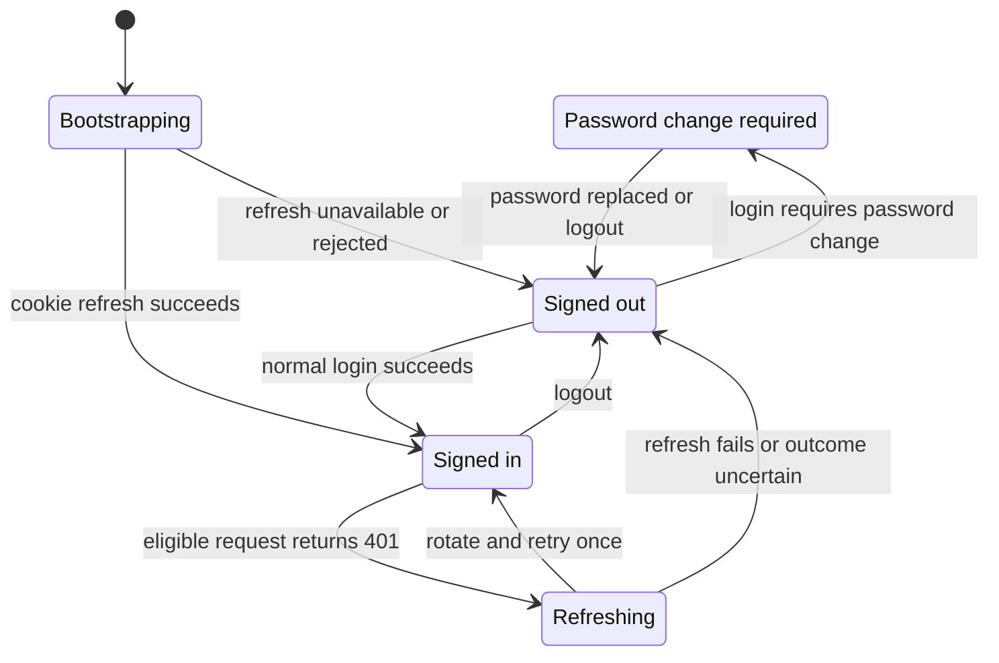

# BAiTI state transitions

Reviewed 12 November 2026 against the *igumi* working tree based on `d5ed66d`, including the local P08 backend. This inventory covers application-owned lifecycles that affect access, records, user-visible outcomes, retries or recovery. A **live workflow** has an application path that performs the transition. A **live gate** reads a state that can affect a request. A **planned workflow** has requirements or persistence support and awaits its application path.

Use the [SRS](01_SRS.md), [system analysis](02_SYSTEM_ANALYSIS.md), [architecture](03_ARCHITECTURE.md), [schema](04_DATABASE_DESIGN.md) and owning packet for the rules. The links below trace observed behavior to the code or tests that enforce it.

The account administration rows were updated on 22 November 2026 for the P09
user administration slice. Other rows retain their dated review above.

## Live application workflows and gates

| Lifecycle | Current states, triggers and outcomes | Evidence |
|---|---|---|
| Tenant availability | Onboarding creates an `ACTIVE` tenant. Request resolution accepts active tenants only. Unknown and `SUSPENDED` tenants share the generic authentication failure. Platform list includes both statuses. Setting tenant status is a planned FR-TEN-06 action. | [Directory][directory], [tenant request filter][tenant-filter], [onboarding][onboarding], [tenant directory tests][directory-it] |
| Tenant onboarding | Slug available → tenant, roles, permissions, grants, first-use Admin and audit committed in one transaction. A duplicate slug returns `409`. A failed step rolls back every insert. | [Onboarding][onboarding], [platform tests and I9][platform-it] |
| Tenant account eligibility | `USER_MANAGE` creates an `ACTIVE`, first-use account with a generated temporary password returned once. Role assignment revokes refresh credentials. Deactivation changes `ACTIVE` → `INACTIVE` and revokes refresh credentials atomically with its audit. Repeating deactivation returns `204` without another audit entry. `INACTIVE` accounts fail sign-in, `/me` and refresh. Ordinary protected tenant requests trust signed access claims until expiry, subject to live tenant resolution. | [User administration](../../backend/src/main/java/my/baiti/people/UserAdminService.java), [People API tests](../../backend/src/test/java/my/baiti/testing/PeopleModuleIT.java), [user authentication][user-auth], [tenant bearer filter][bearer] |
| First-use password | `mustChangePassword=true` → restricted bearer, empty permissions and an expired refresh cookie. The bearer allows `/me`, `/password` and `/logout`. Verified replacement clears the flag and revokes user refresh credentials atomically. The API returns `204` and clears the cookie. A fresh login issues normal credentials. A previously issued restricted bearer keeps its signed restrictions. | [Auth service][auth-service], [auth controller][auth-controller], [tenant bearer filter][bearer], [auth tests][auth-it] |
| Tenant access token | Signed bearer → valid until its expiry if audience, claims, signature and tenant match. Invalid, expired or mismatched requests receive `401`. Restricted first-use access to a business route receives `403`. Logout revokes refresh credentials and clears the cookie. A previously issued ordinary bearer retains its signed lifetime, with a configured upper bound of 15 minutes. | [JWT validation][jwt], [tenant bearer filter][bearer], [auth service][auth-service], [auth architecture](03_ARCHITECTURE.md#7-security-architecture) |
| Refresh token and family | Issued → usable → rotated, expired or revoked. Rotation locks the row and creates a same-family successor in a transaction. The replay branch takes precedence once a row has `rotatedAt` and commits family revocation before returning `401`. A usable token whose user is inactive revokes that user's refresh rows. Logout and first-use replacement revoke all user refresh rows. A still-restricted user cannot refresh. Cleanup of expired rows is planned. | [Rotation service][rotation], [refresh repository][refresh-repo], [auth tests including concurrent replay][auth-it] |
| Platform operator and token | `ACTIVE` operator with valid credentials → platform bearer. Each protected platform request checks operator activity again. `SUSPENDED` or missing operator and expired or invalid bearer receive `401`. A valid tenant bearer on a protected platform route receives `403`. The platform API exposes sign-in and tenant operations. | [Platform authentication][platform-auth], [platform token filter][platform-filter], [platform tests][platform-it] |
| Authentication throttle | An IP or tenant-account bucket consumes capacity, exhausts, and refills with elapsed time. At the key cap, a new key is denied until idle entries are evicted. The endpoint returns `429` with `Retry-After: 60`. The login and refresh IP buckets are separate. The login bucket covers tenant sign-in, platform sign-in and initial password replacement. | [Limiter][limiter], [limit filter][limit-filter], [problem response][problem], [limiter tests][limiter-test] |
| Grants and permission snapshot | Grant rows move between present and absent through the domain methods. Onboarding seeds defaults. Startup sync adds missing catalogue entries and default roles under a per-tenant lock, preserving existing revocations and custom roles. Login or refresh issues the current permissions into the bearer. Changing stored grants leaves previously signed claims valid through their lifetime. The role-management API is planned in P09. | [Role grants][role], [permission sync][sync], [permission tests][sync-it], [auth service][auth-service], [P09](08_ai_packets/PACKET_09_people.md) |
| Resident link and scope | A resident may be unlinked or linked to a portal user, with `ACTIVE` or `MOVED_OUT` status. Linked records can satisfy the own-resident predicate after move-out. Active-unit access requires a live link and `ACTIVE` status. Unlinking removes both predicates. The partial unique index permits one active residency per linked user per tenant. P09 owns the lifecycle writes. | [Resident predicates][resident-access], [scope guard][resident-guard], [resident scope tests][resident-it], [V11][v11], [P09](08_ai_packets/PACKET_09_people.md) |
| Unit occupancy | Create defaults to `VACANT` when status is omitted. P08 supports manual writes to `OCCUPIED` and `VACANT`, including repeated values. P09 plans occupancy derived from active residency on assignment and move-out. Guards receive unit numbers through the unit read projection. | [Unit service][unit], [property tests][property-it], [P08](08_ai_packets/PACKET_08_property.md), [P09](08_ai_packets/PACKET_09_people.md) |
| Property existence and deletion | Absent → created → updated or deleted. Uniqueness is enforced per tenant for block name and per block for unit number. A referenced block or unit remains present after delete returns `409`, including units with retained resident history. Missing and foreign IDs have the same neutral `404`. A successful write records a property audit event in the same transaction. | [Block service][block], [unit service][unit], [property error handler][property-errors], [activity writer][writer], [property tests][property-it], [V32][v32] |

## Request and background lifecycles

| Lifecycle | Current states and transition owner | Evidence |
|---|---|---|
| Request and database tenant scope | Request starts clear → resolver binds an active tenant → tenant bearer must match → Hibernate and the borrowed connection enforce the scope → filter clears it. The datasource sets or resets scope on borrow, rolls back unfinished work on release, resets before reuse, and evicts an unsafe connection. Platform work has its own scope and role boundary. | [Request filter][tenant-filter], [tenant datasource][datasource], [security chains][security], [isolation suite][isolation-it] |
| Tenant permission reconciliation | Startup begins unscoped → binds each tenant → applies one advisory-lock-protected transaction → clears context in `finally`. A complete re-run preserves catalogue and grants already reconciled. | [Startup runner][sync-start], [permission sync][sync], [permission tests][sync-it] |
| Authentication audit | Event accepted for a resolved tenant → queued on a bounded executor → worker binds scope → append or log failure → clear. Enqueue rejection and append failure are logged. Property and onboarding audit entries are written on their respective business transactions. | [Publisher][audit-publisher], [executor][audit-executor], [worker][audit-worker], [activity writer][writer], [I8][isolation-it], [I9][platform-it] |
| Development seeding | Disabled by default. When enabled, a marked local dev target and an active operator permit each synthetic tenant to be created through onboarding. Matching active seed → reuse. An incompatible slug or invalid preflight fails startup. Each community has its own onboarding transaction, so restart can complete a partial run. | [Dev seed runner][dev-seed], [dev smoke evidence](../ai-context/06_TESTING_EVIDENCE/2026-11-08_dev_authentication.md) |

## Planned workflows and stored state

| Lifecycle | Blueprint intent and current foundation | Owning references |
|---|---|---|
| Tenant status and role permission administration | Setting tenant `ACTIVE`/`SUSPENDED` awaits FR-TEN-06. Role permission editing and system-role deletion protection await later P09 work. Account creation, assignment and deactivation are live above. | [FR-TEN-06 and FR-RBAC-05](01_SRS.md), [P09](08_ai_packets/PACKET_09_people.md), [V2][v2], [V7][v7] |
| Emailed password reset | Time-boxed reset credential is planned. Issuance, expiry, consumption and the session consequence belong to that workflow when specified. | [FR-AUTH-07](01_SRS.md), [P09 scope](08_ai_packets/PACKET_09_people.md) |
| Residents and family | Create or link resident, move out while retaining history, update occupancy when active links change. Family add/edit/remove follows own-record scope. Ownership types are classifications. | [P09](08_ai_packets/PACKET_09_people.md), [V11][v11] |
| Payment method availability | `is_active` is stored and the repository can select active methods. P10 owns payment-method management and the payment-side usability guard. | [Payment method repository][method-repo], [P10](08_ai_packets/PACKET_10_finance.md), [V13][v13] |
| Bill and payment | Issue `UNPAID`. A partial payment changes the balance. Exact cover → `PAID`. P17 moves unpaid past-due bills → `OVERDUE`. Analysis permits cancellation from `UNPAID` with a reason. Payments are append-only under runtime grants. Payment recording and balance recomputation share a planned locked transaction. | [Billing workflow](02_SYSTEM_ANALYSIS.md#43-bill--payment-lifecycle-uc-f1f2), [P10](08_ai_packets/PACKET_10_finance.md), [P17](08_ai_packets/PACKET_17_notification_centre.md), [V14][v14], [V28][v28] |
| Complaint and history | `OPEN → IN_PROGRESS → RESOLVED → CLOSED` or `OPEN → REJECTED`. Analysis and P11 also describe resident reopen from `RESOLVED`. Staff/owner guards, resulting-state history, required messages and notification effects belong to P11. Persistence currently protects complaint history from parent deletion. | [FR-CMP-02](01_SRS.md), [complaint workflow](02_SYSTEM_ANALYSIS.md#44-complaint-lifecycle-uc-c1c2), [P11](08_ai_packets/PACKET_11_complaints.md), [V17][v17], [V18][v18] |
| Maintenance | `PENDING → APPROVED → IN_PROGRESS → COMPLETED`. SRS and P12 specify `PENDING → REJECTED` with a reason. Priority is a queue classification. | [FR-MNT-02](01_SRS.md), [P12](08_ai_packets/PACKET_12_maintenance.md), [V19][v19] |
| Facility availability | `AVAILABLE`, `MAINTENANCE` and `CLOSED` are stored. P14 blocks new bookings in the latter two states and preserves history. | [P14](08_ai_packets/PACKET_14_facilities.md), [V20][v20] |
| Facility booking | `PENDING → APPROVED` or `REJECTED` by staff. Booker cancellation from `PENDING` or `APPROVED` is limited to before slot start in the detailed workflow. Only pending and approved reservations hold the slot in the unique index. | [Booking workflow](02_SYSTEM_ANALYSIS.md#45-facility-booking-uc-b1b2-v1x), [P14](08_ai_packets/PACKET_14_facilities.md), [V21][v21] |
| Visitor pre-registration | `PENDING → USED` when a same-day code check-in creates the visit. The nightly job plans `PENDING → EXPIRED`. `CANCELLED` is a stored value with no cancellation route described in P16. Code uniqueness and the planned atomic use transition are distinct controls. | [P16](08_ai_packets/PACKET_16_visitors.md), [V24][v24], [V25][v25] |
| Visitor presence | Pre-registration use or walk-in → `CHECKED_IN`. Check-out stamps exit time and should align `CHECKED_OUT` with that timestamp. On-site means entry recorded and exit absent. V25 enforces timestamp ordering. P16 owns the write consistency and the single-use code race. | [Visitor workflow](02_SYSTEM_ANALYSIS.md#46-visitor-flow-uc-v1v2-v1x), [P16](08_ai_packets/PACKET_16_visitors.md), [V25][v25] |
| Announcements and events | Publication, editing and deletion are planned CRUD, with audience visibility based on resident type. The event interval can support derived display phases. The schema stores dates and validates order. Audience labels are classifications. | [P15](08_ai_packets/PACKET_15_community.md), [V22][v22], [V23][v23] |
| Notifications and scheduled work | Notification defaults to unread. Mark-one/read-all, unread count, scheduled overdue and expiry work are planned. The overdue job changes only eligible `UNPAID` rows on each run. The channel seam includes a log-only email stub. | [P17](08_ai_packets/PACKET_17_notification_centre.md), [V26][v26] |

## Decisions to carry into the next change

The app should expose a workflow through the existing backend contract. For each new or changed action, record the **current state → action → outcome**, the actor and guards, the atomic write and audit/notification effects, and the response for denial, conflict, replay or uncertain completion. Link the existing service, migration and tests. Add or update the transition and boundary cases in the packet's existing tests when behavior changes. Keep the transition rule with its owning domain service or its small pure guard. The database remains authoritative for concurrent uniqueness and tenant integrity.

Use the same record to drive labels, available actions and recovery in the UI. Generated API types and the existing problem response shape are the integration surface for clients and agents. Agents can use the recorded route, permission, test and retry rule without reverse-engineering a status enum or parsing human-readable `detail` as an error code. Apply the practice with each workflow change.

### First consumer in the P07 frontend shell

On load, cookie refresh settles the client in **signed in** or **signed out**. Sign-in can also enter **password change required**. The sign-in response includes `user.mustChangePassword`, which drives the password-change route. A `204` from password replacement returns the user to sign-in. Keep access tokens in memory.

On bootstrap or an eligible protected-request `401`, use one shared cookie refresh per client at a time. Send credentials and `X-BAiTI-Refresh: true` to the configured origin. A successful refresh allows one retry of the rejected request. A failed refresh or uncertain rotation outcome calls for a new sign-in, since resending an already-rotated token revokes the family. A `401` from the sign-in attempt belongs to the sign-in form. Treat `403` as an access or first-use outcome, `404` as neutral, `409` as a conflict with server state, and `429` as a wait using `Retry-After`. Preserve correctable fields on `400` and `409`. For an ambiguous mutation response, read the resource or list again before repeating the write. The P08 editor retains the draft and requires a successful list reload before it re-enables the write. Clear the local bearer and tenant-scoped cache on logout. Treat a server `204` as confirmation that refresh credentials were revoked. Use the Guard response schema for the Guard view.

### Resolve with the owning packets

- **P09 user deactivation.** Define when an already-issued tenant bearer should stop working on ordinary routes. Current ordinary routes check tenant availability and signed claims. `/me` and refresh also check live user activity.
- **P10 bill cancellation.** Only UNPAID bills may be cancelled, with a reason. Other statuses return 409. P10 and the detailed lifecycle now agree.
- **P11 resident reopen.** The submitting resident may close or reopen their own resolved complaint. FR-CMP-02 now matches the detailed lifecycle and P11.
- **P12 rejection.** Staff may reject a pending request with a reason. System analysis now matches FR-MNT-02 and P12.
- **P14 booking cancellation.** The booker may cancel a pending or approved booking before its slot starts. FR-FAC-03 now matches the detailed workflow.
- **P16 visit consistency.** A unique approval code identifies a registration. V25 permits multiple visit rows referencing that registration and checks timestamp order independently of the stored status. P16 needs a concurrent single-use check and a consistent check-out write.

[directory]: ../../backend/src/main/java/my/baiti/tenancy/TenantDirectory.java
[tenant-filter]: ../../backend/src/main/java/my/baiti/tenancy/TenantContextFilter.java
[onboarding]: ../../backend/src/main/java/my/baiti/tenancy/admin/TenantOnboardingService.java
[directory-it]: ../../backend/src/test/java/my/baiti/tenancy/TenantDirectoryIT.java
[platform-it]: ../../backend/src/test/java/my/baiti/security/PlatformAuthIT.java
[user-auth]: ../../backend/src/main/java/my/baiti/people/UserAuthenticationService.java
[bearer]: ../../backend/src/main/java/my/baiti/security/JwtAuthenticationFilter.java
[auth-it]: ../../backend/src/test/java/my/baiti/security/AuthenticationFlowIT.java
[auth-service]: ../../backend/src/main/java/my/baiti/security/AuthService.java
[auth-controller]: ../../backend/src/main/java/my/baiti/security/AuthController.java
[jwt]: ../../backend/src/main/java/my/baiti/security/JwtService.java
[rotation]: ../../backend/src/main/java/my/baiti/security/RefreshTokenService.java
[refresh-repo]: ../../backend/src/main/java/my/baiti/security/RefreshTokenRepository.java
[platform-auth]: ../../backend/src/main/java/my/baiti/tenancy/admin/PlatformAuthentication.java
[platform-filter]: ../../backend/src/main/java/my/baiti/tenancy/admin/PlatformTokenFilter.java
[limiter]: ../../backend/src/main/java/my/baiti/security/LoginRateLimiter.java
[limit-filter]: ../../backend/src/main/java/my/baiti/security/LoginRateLimitFilter.java
[problem]: ../../backend/src/main/java/my/baiti/common/ApiError.java
[limiter-test]: ../../backend/src/test/java/my/baiti/security/LoginRateLimiterTest.java
[role]: ../../backend/src/main/java/my/baiti/people/Role.java
[sync]: ../../backend/src/main/java/my/baiti/people/PermissionSyncService.java
[sync-it]: ../../backend/src/test/java/my/baiti/people/PermissionSyncIT.java
[resident-access]: ../../backend/src/main/java/my/baiti/people/ResidentAccessService.java
[resident-guard]: ../../backend/src/main/java/my/baiti/security/ResidentScopeGuard.java
[resident-it]: ../../backend/src/test/java/my/baiti/security/ResidentScopeIT.java
[unit]: ../../backend/src/main/java/my/baiti/property/UnitService.java
[block]: ../../backend/src/main/java/my/baiti/property/BlockService.java
[property-errors]: ../../backend/src/main/java/my/baiti/property/PropertyExceptionHandler.java
[property-it]: ../../backend/src/test/java/my/baiti/testing/PropertyModuleIT.java
[writer]: ../../backend/src/main/java/my/baiti/system/TenantActivityWriter.java
[datasource]: ../../backend/src/main/java/my/baiti/config/TenantAwareDataSource.java
[security]: ../../backend/src/main/java/my/baiti/config/SecurityConfig.java
[isolation-it]: ../../backend/src/test/java/my/baiti/testing/TenantIsolationIT.java
[sync-start]: ../../backend/src/main/java/my/baiti/tenancy/PermissionSyncStartup.java
[audit-publisher]: ../../backend/src/main/java/my/baiti/system/TenantActivityPublisher.java
[audit-executor]: ../../backend/src/main/java/my/baiti/config/AuditExecutionConfig.java
[audit-worker]: ../../backend/src/main/java/my/baiti/tenancy/TenantActivityListener.java
[dev-seed]: ../../backend/src/main/java/my/baiti/config/DevDataInitializer.java
[method-repo]: ../../backend/src/main/java/my/baiti/finance/PaymentMethodRepository.java
[v2]: ../../backend/src/main/resources/db/migration/V2__tenants.sql
[v7]: ../../backend/src/main/resources/db/migration/V7__users.sql
[v11]: ../../backend/src/main/resources/db/migration/V11__residents.sql
[v13]: ../../backend/src/main/resources/db/migration/V13__payment_methods.sql
[v14]: ../../backend/src/main/resources/db/migration/V14__bills.sql
[v17]: ../../backend/src/main/resources/db/migration/V17__complaints.sql
[v18]: ../../backend/src/main/resources/db/migration/V18__complaint_updates.sql
[v19]: ../../backend/src/main/resources/db/migration/V19__maintenance_requests.sql
[v20]: ../../backend/src/main/resources/db/migration/V20__facilities.sql
[v21]: ../../backend/src/main/resources/db/migration/V21__facility_bookings.sql
[v22]: ../../backend/src/main/resources/db/migration/V22__announcements.sql
[v23]: ../../backend/src/main/resources/db/migration/V23__events.sql
[v24]: ../../backend/src/main/resources/db/migration/V24__visitor_pre_registrations.sql
[v25]: ../../backend/src/main/resources/db/migration/V25__visitors.sql
[v26]: ../../backend/src/main/resources/db/migration/V26__notifications.sql
[v28]: ../../backend/src/main/resources/db/migration/V28__enable_rls.sql
[v32]: ../../backend/src/main/resources/db/migration/V32__enforce_same_tenant_foreign_keys.sql
